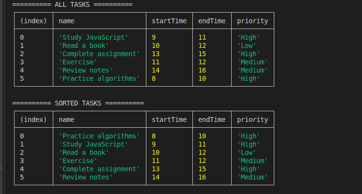
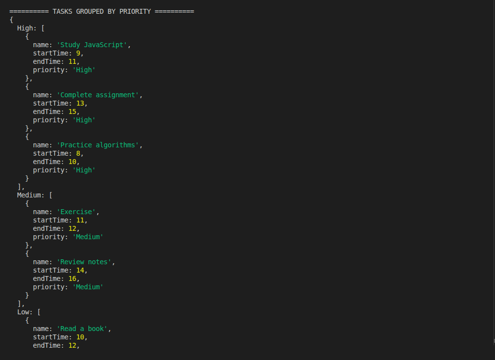
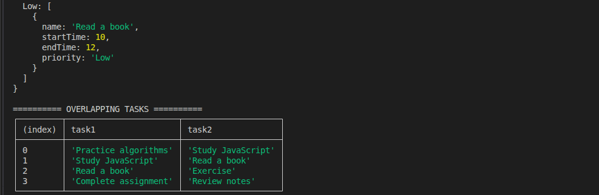

# GMC-Optimizing-Task-Scheduling-System

A lightweight task scheduler built with JavaScript. This project demonstrates task sorting, priority grouping, and overlap detection while analyzing the time and space complexity of each operation.

## Features

- **Task Management:** Stores each task's name, start time, end time, and priority.
- **Sort Tasks:** Sorts tasks by start time using JavaScript's built-in `sort()` method.
- **Group by Priority:** Organizes tasks into High, Medium, and Low priority groups using an object containing arrays.
- **Detect Overlapping Tasks:** Identifies pairs of tasks that run at the same time.
- **Display Results:** Prints tasks and results in the terminal using `console.log()` and `console.table()`.

## Tests

